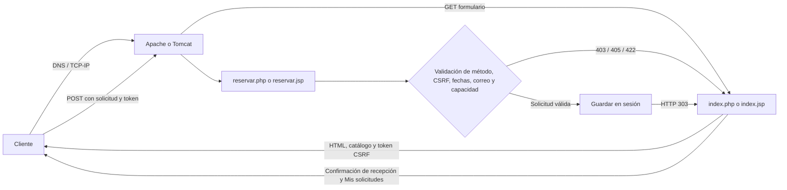

# AURELIA | Hotel & Suites

Propuesta académica de un sistema de solicitudes de reserva inspirado en el PDF **AURELIA Hotel & Suites**. Incluye dos implementaciones equivalentes —PHP y JSP—, una galería hotelera y un flujo de reserva con almacenamiento temporal por sesión.

La identidad visual usa los tonos marfil, verde profundo y dorado de la propuesta. Las seis imágenes del hero, las habitaciones y la experiencia se extrajeron del PDF proporcionado para la práctica y se sirven localmente, sin CDN ni recursos externos.

## Estructura

```text
.
├── php-app/
│   ├── assets/images/       # Fotografías incluidas en la propuesta Aurelia
│   ├── assets/reservas.js   # Resumen de noches, tarifa y navegación móvil
│   ├── assets/styles.css
│   ├── bootstrap.php
│   ├── index.html           # Redirección de compatibilidad a index.php
│   ├── index.php
│   └── reservar.php
├── jsp-app/
│   ├── assets/images/
│   ├── assets/reservas.js
│   ├── assets/styles.css
│   ├── WEB-INF/hotel-common.jspf
│   ├── WEB-INF/web.xml
│   ├── error.jsp
│   ├── index.jsp
│   └── reservar.jsp
├── evidencias/
└── README.md
```

## Funcionalidades

- Portada fotográfica, catálogo de habitaciones, sección de experiencia y navegación adaptable a móvil.
- Cuatro habitaciones, capacidades y precios referenciales basados en la propuesta:

| Habitación | Capacidad | Tarifa por noche |
|---|---:|---:|
| Deluxe Room | 2 huéspedes | S/ 280 |
| Premium Twin | 2 huéspedes | S/ 350 |
| Junior Suite | 3 huéspedes | S/ 480 |
| Royal Suite | 4 huéspedes | S/ 750 |

- Solicitud con nombre, correo, habitación, llegada, salida, huéspedes y preferencias opcionales.
- Total referencial calculado en el navegador y recalculado en el servidor.
- Resumen de solicitudes en la sesión actual, con referencia y estado pendiente de confirmación.
- Validación de fechas, estancia de hasta 30 noches y límite de huéspedes de cada habitación.
- Tokens CSRF, escape de salida, códigos HTTP 403, 405 y 422, cookies de sesión protegidas y errores 500 sin detalles internos.
- Límite de 50 solicitudes recientes por sesión.

> **Maqueta académica:** las imágenes son ilustrativas y ficticias, las tarifas son referenciales y las solicitudes solo se guardan en la sesión del navegador. La web no consulta disponibilidad real, no bloquea habitaciones, no procesa pagos y no envía correos. Aurelia debe confirmar cada solicitud.

## Despliegue PHP con XAMPP

1. Copia `php-app` a `C:\xampp\htdocs\php-app`.
2. Inicia Apache en el panel de XAMPP.
3. Abre `http://localhost/php-app/`.
4. Completa el formulario y revisa **Mis solicitudes** al final de la página.

La entrada dinámica `index.php` crea la sesión y el token CSRF. `index.html` conserva el acceso de compatibilidad y redirige al formulario seguro.

## Despliegue JSP con Tomcat

1. Copia `jsp-app` a `C:\xampp\tomcat\webapps\jsp-app` (o a la carpeta `webapps` de tu instalación Tomcat).
2. Inicia Tomcat desde XAMPP.
3. Abre `http://localhost:8080/jsp-app/`.
4. Completa el formulario y revisa **Mis solicitudes**.

Tomcat compila los JSP al primer acceso. `WEB-INF/web.xml` define la sesión, la página de bienvenida y el manejo de errores; `hotel-common.jspf` comparte el catálogo y las funciones de escape y validación entre los JSP.

## Flujo HTTP



DNS resuelve el nombre del servidor; TCP/IP transporta la conexión; HTTP define la solicitud y la respuesta. Apache ejecuta PHP y Tomcat compila JSP a servlet. El navegador recibe HTML y recursos estáticos, no el código del servidor.

## Comparativa PHP y JSP

| Aspecto | PHP | JSP |
|---|---|---|
| Ciclo de vida | Apache ejecuta PHP por solicitud; `$_SESSION` conserva las solicitudes durante la sesión. | Tomcat traduce JSP a servlet; `HttpSession` conserva las solicitudes durante la sesión. |
| Entrada y validación | `$_POST`, filtros de correo, longitudes, fechas, capacidad y token CSRF. | `request.getParameter()`, validaciones Java, fechas, capacidad y token CSRF. |
| Salida segura | `htmlspecialchars` con UTF-8 y comillas. | `escapeHtml` con entidades para los caracteres especiales HTML. |
| Despliegue | PHP y Apache/XAMPP. | JDK y contenedor Servlet como Tomcat. |
| Estado | Cookie de sesión HTTP, marcada `HttpOnly` y `SameSite=Lax`. | Cookie `JSESSIONID` y estado temporal en `HttpSession`. |
| Errores | 403, 405 y 422; página genérica 500 y log del servidor. | 403, 405 y 422; página genérica 500 configurada en `web.xml` y log del servidor. |

El rendimiento real depende de la carga y configuración del servidor; no se atribuye una diferencia de velocidad sin mediciones.

## Pruebas recomendadas

1. Enviar una solicitud válida y verificar referencia, noches, total y conservación en **Mis solicitudes**.
2. Probar cada habitación y comprobar que el máximo de huéspedes se actualiza al seleccionar otra categoría.
3. Rechazar correo mal formado, llegada pasada, salida anterior/igual a llegada y estancia mayor a 30 noches.
4. Seleccionar más huéspedes que la capacidad de una habitación y comprobar que el servidor rechaza la solicitud.
5. Enviar `<script>alert(1)</script>` en nombre o preferencias; debe aparecer como texto escapado, nunca ejecutarse.
6. Eliminar o alterar el token CSRF y volver a usar un token ya consumido; la solicitud debe rechazarse con HTTP 403.
7. Solicitar `reservar.php` o `reservar.jsp` por GET; se espera HTTP 405.
8. Repetir solicitudes dentro de la misma sesión y abrir una sesión nueva; las listas deben mantenerse aisladas y conservar como máximo 50 elementos.
9. Verificar el formulario, el catálogo, la navegación y los resúmenes en escritorio y móvil; no debe existir desbordamiento horizontal.
10. Revisar la pestaña **Network** y los logs de Apache/Tomcat. En esta maqueta, no confundir “solicitud recibida” con una reserva confirmada.
